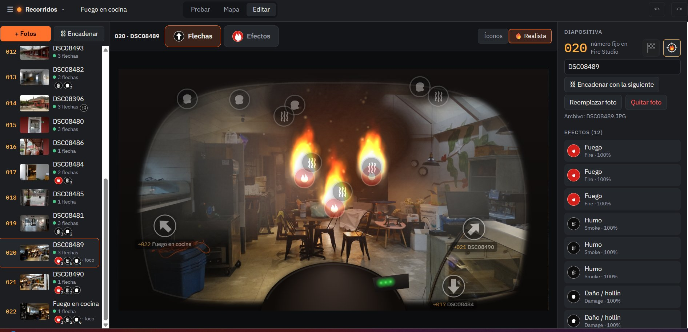
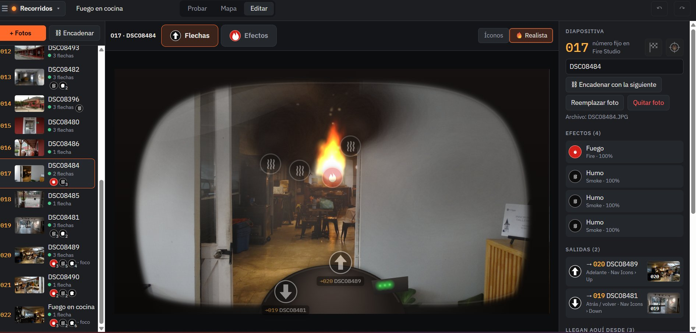
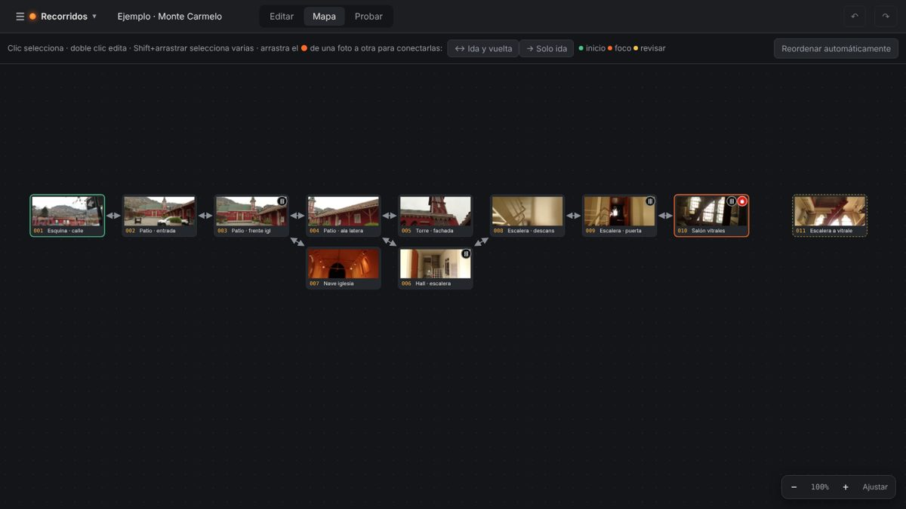

# Planificador de recorridos · simulaciones de incendio para Fire Studio

**Primero el recorrido, después el programa.** El Planificador de recorridos permite armar, probar y presentar una simulación de incendio con las fotos de un edificio **antes** de pasarla a [Fire Studio 7](https://www.digitalcombustion.com/) (Digital Combustion). Las flechas apuntan a fotos y no a números, así que el recorrido no se desarma al mover o borrar una diapositiva.

- **Aplicación publicada:** https://lechugaluminio.github.io/Planificador-de-recorridos/
- **Video (30–60 s):** *(completar con el enlace)*
- Proyecto personal de Daniel Victoriano · Diseño Industrial UDP. Hecho para el entrenamiento de bomberos con Fire Studio 7 (licencia de instructor).



*Escenario «Fuego en cocina» (Monte Carmelo, Santiago), diapositiva 020: fuego y humo animados, vista desde la máscara del equipo autónomo y flechas hacia las fotos vecinas.*

---

## 1. Concepto

Una simulación en Fire Studio es una secuencia de fotos de un edificio por la que el alumno avanza con flechas, como si caminara hacia la emergencia. El trabajo más largo no son los efectos: es **enlazar las diapositivas**. En Fire Studio cada flecha salta a "la diapositiva número X". Si se mueve o se borra una diapositiva, todos los números se corren y los enlaces quedan apuntando a lugares equivocados.

El planificador cambia el orden de trabajo:

- **Las flechas apuntan a fotos.** Cada foto recibe un número de diapositiva **permanente**. Quitar una foto la deja vacante; nunca se renumera nada sin que uno lo pida.
- **El recorrido se piensa como un mapa.** Se ve el edificio completo como un plano de conexiones, se crean escenarios desde un levantamiento *master* y se detectan fotos sin salida o a las que no se llega.
- **Se prueba antes de construir.** El modo Probar recorre el escenario como lo verá el alumno, con fuego, humo, humo ambiente y la vista desde la máscara. Así el escenario se puede presentar y aprobar antes de dedicar horas a Fire Studio.
- **Fire Studio recibe instrucciones exactas.** La exportación entrega las fotos numeradas en orden y la hoja de enlaces (qué flecha, dónde, de qué tamaño y a qué diapositiva), más un ayudante que configura cada flecha en Fire Studio.

**Qué queremos lograr:** que el instructor dedique su tiempo a decidir **qué** va a vivir el alumno (por dónde entra, qué ve, dónde está el foco) y no a corregir números de diapositiva.

---

## 2. Cómo se usa

1. **Levantar el edificio.** Fotografiar desde la calle (frontis y laterales) y luego el interior, en el orden en que se avanzaría. El gran angular del teléfono ayuda a mantener la conciencia situacional. La app `captura/` permite hacerlo en terreno, por recorridos.
2. **Cargar las fotos.** Menú ☰ → *Importar fotos…*. Cada foto queda con su número fijo (001, 002…).
3. **Conectar.** En **Editar**: clic en la foto donde va la flecha → tipo de flecha → foto de destino. La flecha de regreso se crea sola. En **Mapa**: arrastrar el **●+** de una foto a otra.
4. **Marcar el inicio y el foco.** Botones **⚑** (bandera a cuadros: punto de partida) y **◎** (fuego con mira: foco / final), junto al número de la diapositiva.
5. **Poner efectos.** Fuego, humo, explosión, hollín y materiales peligrosos; en interiores, **humo ambiente** con plano neutro y **vista desde la máscara**.
6. **Probar.** Recorrer el escenario como alumno. Al volver a Editar o al Mapa, queda abierta la foto que se estaba viendo.
7. **Exportar.** Menú ☰ → *Exportar…*: el `.zip` para Fire Studio o la **presentación** `.html` para mostrar el escenario en un computador o en el celular.
8. **Armar en Fire Studio** siguiendo la hoja de enlaces (o con el ayudante de flechas, sección 3.6).



---

## 3. Funcionamiento

### 3.1 Vistas

| Vista | Tecla | Para qué sirve |
|---|---|---|
| **Probar** | `Q` | Recorrer el escenario como el alumno, con los efectos animados (Realista / Íconos / Sin efectos) |
| **Mapa** | `W` | Ver todo el edificio como plano de conexiones; seleccionar, encadenar, conectar y crear escenarios |
| **Editar** | `E` | Poner flechas y efectos sobre cada foto, nombrarlas, marcar inicio y foco |

Las pestañas están en el mismo orden que las teclas **Q W E** del teclado.



### 3.2 Flechas ↔ Fire Studio

Cada tipo de flecha corresponde a un ícono de la librería **Nav Icons** de Fire Studio:

| Flecha en el planificador | Ícono en Fire Studio | Uso típico |
|---|---|---|
| Adelante | `NV-Up` | Avanzar de frente |
| Entrar | `NV-In` | Cruzar una puerta o entrar a un recinto |
| Diagonal izq. / der. | `NV-LCorner` / `NV-RUCorner` | Doblar en una esquina |
| Izquierda / Derecha | `NV-Left` / `NV-Right` | Girar en el lugar |
| Abajo izq. / der. | `NV-LLCorner` / `NV-RLCorner` | Bajar o retroceder en diagonal |
| Atrás / volver | `NV-Down` | Regresar a la foto anterior |

- **Crear:** clic en la foto. Se abre la ventana de destino con las miniaturas numeradas; se puede **mover** (arrastrando el título) y **agrandar** (esquina ◢), y recuerda su posición y tamaño.
- **Tamaño:** rueda del mouse justo después de poner o tocar la flecha.
- **Al seleccionar una flecha**, el panel muestra justo debajo hacia dónde lleva (miniatura con número) y desde dónde se llega. Las acciones de la foto completa, como *Quitar foto*, bajan al final para no confundirlas con *Borrar*.

### 3.3 Efectos ↔ librerías de Fire Studio

| Marcador | Color | Librería sugerida en Fire Studio | En modo Realista |
|---|---|---|---|
| Fuego | rojo | `Fire` | Llamas animadas con brillo y chispas |
| Humo | negro | `Smoke` | Columna de humo oscuro que sube |
| Explosión | rojo | `Explosions` | Estallido de fuego |
| Daño / hollín | negro | `Damage` | Manchas de hollín |
| Mat. peligrosos | amarillo | `Haz Mat` | Nube verdosa baja |

Los marcadores no se exportan como capas: indican **dónde** y **de qué tamaño** poner la capa de la librería en Fire Studio. Un efecto se copia a otra foto arrastrándolo a la lista.

### 3.4 Ambiente interior

| Ajuste | Qué hace | Cuándo usarlo |
|---|---|---|
| **Humo ambiente** (0–100 %) | Capa gris difusa que se mueve lento sobre toda la foto | Bajar la visibilidad en un interior con humo |
| **Plano neutro** (altura) | Sobre la línea el humo es denso; bajo ella, mucho más tenue | Mostrar la estratificación real del humo en un recinto |
| **Vista desde la máscara** | Visor curvo, copa nasal, regulador con luces verdes y vaho de la respiración | Fotos tomadas desde la posición del bombero con equipo autónomo |
| **Copiar a otras fotos…** | Copia el ambiente a las fotos que se marquen | Aplicar el mismo ambiente a todo un piso |

Se ven en modo Realista, en Probar y en la presentación descargada.

### 3.5 Exportación

| Archivo | Contenido | Para qué |
|---|---|---|
| `fotos/001_Nombre.jpg …` | Fotos renombradas en orden, con luz y contraste igualados (opcional). Calidad: Estándar 1920 px, Alta 2560 px o Máxima 3200 px | Fondos de las diapositivas en Fire Studio |
| `hoja_enlaces.html` | Cada diapositiva con sus flechas (ícono, posición, tamaño, destino) y efectos | Tenerla al lado mientras se arma |
| `enlaces.csv` · `efectos.csv` | Lo mismo, en tabla | Planillas y el ayudante de flechas |
| `proyecto_recorrido.json` | El proyecto completo | Seguir editando otro día |
| `presentacion_*.html` | Escenario navegable en un solo archivo. Calidad: Liviana celular 1280 px o Alta 1920 px | Mostrar y aprobar el escenario (pitch) antes de armarlo |

Después de *Marcar como aplicado*, la herramienta lista solo los **cambios pendientes** para Fire Studio.

### 3.6 Ayudante de flechas para Fire Studio

`planificador-recorridos/tools/flechas_firestudio.ahk` es un script de [AutoHotkey v2](https://www.autohotkey.com/) que lee el `enlaces.csv`. Por cada flecha:

1. Un cartel indica en qué diapositiva va y qué ícono agregar (Library → Nav Icons → Add).
2. Con **F2**, el script escribe en Fire Studio:
   - la posición y el tamaño;
   - la transparencia al 50 %;
   - el evento de la flecha: *Mouse Click Ends Layer* + *When Layer Ends → GoToSlide* con el número de destino.

Fire Studio debe estar maximizado. El script comprueba en la pantalla que cada clic hizo efecto y avisa si algo no calza. **F3** salta una flecha, **F4** vuelve a la anterior y **F10** cierra el ayudante.

El ayudante solo usa la interfaz de Fire Studio, como lo haría una persona: no lee ni modifica sus archivos internos.

### 3.7 Captura en terreno

`captura/` es una app web para el teléfono (Android, Chrome) que levanta el edificio **por recorridos**: edificio → recorridos → estaciones → fotos. Usa la cámara o la galería y funciona sin señal. *Exportar* arma un `.zip` que el planificador abre con las fotos en orden, encadenadas y con el inicio y el foco marcados.

Link para el teléfono: https://lechugaluminio.github.io/Planificador-de-recorridos/captura/ (en Chrome, *⋮ → Agregar a pantalla principal*).

---

## 4. Créditos y autoría

| Elemento | Autor | Licencia / nota |
|---|---|---|
| Concepto, flujo de trabajo y decisiones de diseño | Daniel Victoriano | Proyecto propio |
| Fotografías del ejemplo «Fuego en cocina» (Monte Carmelo, Santiago) | Daniel Victoriano | Propias. Incluidas reducidas en `src/demo.json`; si el repositorio es público, también lo son |
| Código de la aplicación, motor de efectos (`fxengine.js`) y ayudante AutoHotkey | Daniel Victoriano con asistencia de [Claude](https://anthropic.com) (Anthropic) | Sin librerías externas: HTML, CSS y JavaScript |
| Fuego, humo, humo ambiente y máscara | Generados con código (partículas en canvas) | Sin imágenes ni videos de terceros |
| Íconos de flechas y efectos | Dibujados en SVG dentro de la app | Equivalentes a *Nav Icons*, pero no son los archivos de Fire Studio |
| Fire Studio 7 | Digital Combustion, Inc. | Programa con licencia; marca de su dueño |

---

## 5. Reflexión

> **Borrador para reescribir con tus palabras y tu experiencia con los escenarios.** Está pensado como punto de partida, no como texto final.

**Qué aprendimos al ordenar el trabajo.**

- **El problema no era técnico, era de orden.** Fire Studio puede hacerlo todo, pero obliga a pensar en números de diapositiva. Al cambiar los números por fotos, el recorrido se piensa como un espacio y no como una lista.
- **Ver el mapa cambia las decisiones.** Al ver el edificio completo aparecen las fotos sin salida, los caminos que no llevan al foco y los recorridos alternativos (entrada principal, lado B, techo). Desde el *master* salen varios escenarios de un mismo levantamiento.
- **Probar antes de construir ahorra horas.** Un escenario aprobado como presentación ya no se rehace en Fire Studio. La versión estilizada incluso basta para escenarios sencillos.
- **La máscara y el humo cambian la lectura de la foto.** El visor reduce el campo de visión y el plano neutro muestra dónde se puede respirar y ver. La misma foto se siente más cercana a una intervención real.

**Qué queda fuera del sistema.**

- **No reemplaza a Fire Studio.** Los efectos son referencias para ubicar las capas; el escenario final se arma en Fire Studio.
- **El ayudante depende de la pantalla.** Funciona con Fire Studio maximizado y puede necesitar ajustes si cambia la resolución o la versión del programa.
- **Gran angular sin corregir.** Las fotos del teléfono conservan la deformación del lente.
- **Las fotos viven en el navegador.** Si se borran los datos de navegación, la copia segura es *Guardar proyecto* o el `.zip`.

**Mejoras concretas.**

1. **Capas exactas de Fire Studio:** asignar a cada efecto la capa específica de la librería (no solo la librería).
2. **Agregar el ícono automáticamente** en el ayudante, para que cada flecha sea una sola tecla.
3. **Corrección del gran angular** al exportar.
4. **Versión instalable para iPhone y tablets** de la presentación y la captura.

---

## 6. Ejecutar

### Usar la aplicación

- **En línea:** https://lechugaluminio.github.io/Planificador-de-recorridos/ (Chrome o Edge).
- **Sin internet:** abrir `index.html` con doble clic.
- **Ejemplo:** el botón *Ver ejemplo (Fuego en cocina)* carga el camino de la llegada hasta el fuego en la cocina (9 fotos) con sus flechas y efectos reales.

### En Fire Studio (regla de oro)

- Crear las diapositivas **en el orden 001, 002, 003…** y cargar como fondo la foto con ese número.
- **Nunca mover ni borrar diapositivas.** Las fotos nuevas van al final; las vacantes se dejan en blanco.
- Cada flecha es una capa de **Nav Icons** con *Mouse Click Ends Layer* y *When Layer Ends → GoToSlide* hacia la diapositiva de la hoja.

### Atajos de teclado

| Dónde | Tecla | Acción |
|---|---|---|
| Todo | `Q` / `W` / `E` | Probar / Mapa / Editar |
| Todo | `Ctrl+S` | Guardar proyecto (`.json` con fecha y hora) |
| Todo | `Ctrl+Z` / `Ctrl+Y` | Deshacer / rehacer |
| Confirmaciones | `Enter` / `Esc` | Aceptar / cancelar |
| Editar | `E` | Cambiar entre Flechas y Efectos |
| Editar | `↑` `↓` | Foto anterior / siguiente |
| Editar | `Supr` | Borrar la flecha o el efecto seleccionado |
| Editar | rueda (tras poner o tocar un ícono) | Tamaño del ícono |
| Mapa | rueda / arrastrar el fondo | Zoom hacia el cursor / mover la vista |
| Mapa | `Shift` + arrastrar · `Ctrl+A` | Seleccionar varias / todas |
| Mapa | `Supr` | Quitar fotos o borrar la conexión seleccionada |
| Mapa | `+` `-` `0` | Acercar / alejar / ver todo |
| Probar y presentación | `Backspace` | Volver |

### Presentación en celulares

- **Android:** abrir el `.html` con Chrome.
- **iPhone:** abierto como archivo suele mostrar solo una vista previa. Lo confiable es subirlo a una página web (por ejemplo a este repositorio con GitHub Pages) y compartir el link.

### Estructura del repositorio

```
index.html                      ← la app publicada (copia de planificador-recorridos/index.html)
captura/                        ← app de captura en terreno para el teléfono
planificador-recorridos/
  src/app.html                  ← interfaz y lógica (HTML + CSS + JS)
  src/fxengine.js               ← motor de fuego, humo, humo ambiente y máscara
  src/demo.json                 ← fotos reducidas del ejemplo «Fuego en cocina»
  tools/build.py                ← une src/ en index.html
  tools/flechas_firestudio.ahk  ← ayudante de flechas para Fire Studio (AutoHotkey v2)
  docs/                         ← capturas de este README
```

### Modificar la app

1. Editar los archivos de `planificador-recorridos/src/`.
2. Reconstruir: `python planificador-recorridos/tools/build.py` (Python 3, sin dependencias).
3. Copiar `planificador-recorridos/index.html` a la raíz del repositorio (es lo que publica GitHub Pages).
4. Hacer commit de `src/` y de los dos `index.html`.

**GitHub Pages:** *Settings → Pages → Deploy from a branch*, rama `main`, carpeta `/ (root)`.

---

## Datos y privacidad

- Las fotos se procesan solo en el navegador; nada se sube a ningún servidor.
- *Recientes* se guarda en el navegador (IndexedDB), con las fotos en buena resolución. La copia segura es *Guardar proyecto* o el `.zip`.
- Un proyecto reabierto en otro computador viene con miniaturas: al exportar, la app pide cargar los originales y los reconecta por nombre de archivo.

## Aviso

Proyecto independiente, sin relación con Digital Combustion, Inc. "Fire Studio" es marca de su dueño. Esta herramienta **no lee ni escribe** los formatos internos de Fire Studio (`.dcs`, `.lbr`): trabaja con fotos comunes y entrega instrucciones para armar el escenario dentro del programa, usándolo según su documentación.
